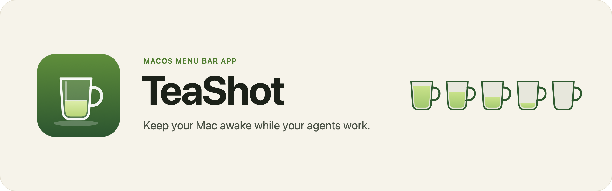
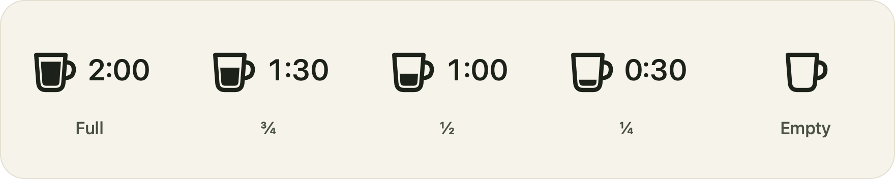
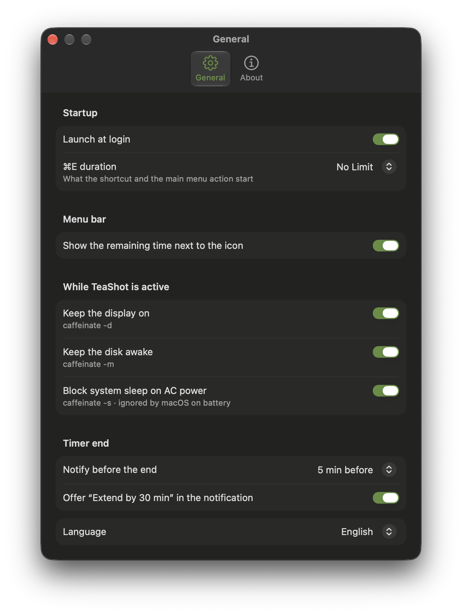

<p align="center">
  <picture>
    <source media="(prefers-color-scheme: dark)" srcset="docs/brand/hero-dark.png">
    <source media="(prefers-color-scheme: light)" srcset="docs/brand/hero-light.png">
    
  </picture>
</p>

<p align="center">
  
  
</p>

**TeaShot keeps your Mac awake from the menu bar.** It does what `caffeinate -dims` does, with a click instead of a terminal, and without touching your Energy or Battery settings. It was built for people who leave AI coding agents such as Claude Code or Codex running for hours: the Mac must not fall asleep in the middle of a task.

<p align="center">
  
</p>

## Install

With [Homebrew](https://brew.sh):

```sh
brew install --cask pillowpillow/tap/teashot
```

`brew upgrade` then updates TeaShot with the rest of your packages: it quits the app, replaces it and opens it again.

Without Homebrew, paste this line in Terminal:

```sh
curl -fsSL https://raw.githubusercontent.com/PillowPillow/tea-shot/main/install.sh | bash
```

It downloads the latest release, installs it in `/Applications` (or `~/Applications` if that folder is not writable) and launches it. Run the same line again to update.

> **Why not a plain download?** TeaShot is free and is not notarized by Apple, which requires a paid developer account, so macOS blocks the first launch of a copy downloaded with a browser. Both methods above avoid that warning: the Homebrew cask clears the quarantine flag after it installs the app, and files downloaded with `curl` are never quarantined. The script is short and readable: [read `install.sh`](install.sh) before you run it. It checks that the download is complete and undamaged, and refuses to run with `sudo`. If the [GitHub CLI](https://cli.github.com) is installed and signed in, it also verifies that the zip was built by this repository's release workflow.

TeaShot requires macOS 14 Sonoma or later and runs on Apple silicon and Intel Macs.

<details>
<summary><strong>Install manually</strong></summary>

1. Download `TeaShot.zip` from the [latest release](https://github.com/PillowPillow/tea-shot/releases/latest).
2. Unzip it and drag TeaShot to your Applications folder.
3. Open TeaShot. macOS blocks the first launch: open **System Settings → Privacy & Security** and click **Open Anyway**. You only do this once.

Every release zip is built by GitHub Actions from a tagged commit and carries a signed build provenance attestation. To check that your download came from this repository's release workflow, with the [GitHub CLI](https://cli.github.com) signed in:

```sh
gh attestation verify TeaShot.zip --repo PillowPillow/tea-shot \
  --signer-workflow PillowPillow/tea-shot/.github/workflows/release.yml
```

</details>

<details>
<summary><strong>Build from source</strong></summary>

You need Xcode 27 or later. No Apple account is needed: builds are signed to run locally.

```sh
git clone https://github.com/PillowPillow/tea-shot.git
cd tea-shot
make install
```

</details>

**Uninstall:** with Homebrew, run `brew uninstall --cask teashot`. Otherwise quit TeaShot from its menu, then delete `TeaShot.app`. From a source checkout, `make uninstall` does both.

## Features

- **Awake with no limit, or for a set time.** Click the cup and choose **Keep Awake** (<kbd>⌘E</kbd> while the menu is open), or pick 30 minutes, 1, 2, 4, 8 or 12 hours. You choose what it starts in Settings.
- **Extend or stop at any time.** **Extend by 30 min** (<kbd>⌘+</kbd> in the menu) adds time to the running timer.
- **A cup that drains.** The menu bar icon is a glass shot cup of green tea. It empties in five steps as the timer runs out, with the remaining time next to it. You can turn the time off.
- **A reminder before the end.** An optional notification arrives 1, 5 or 10 minutes before the timer ends, with an **Extend by 30 min** button.
- **Launch at login**, if you want TeaShot always at hand.
- **In your language.** TeaShot speaks English, French, Italian and Spanish. It follows the system language; pick another one in Settings and the menu and Settings switch at once.

<p align="center">
  <picture>
    <source media="(prefers-color-scheme: dark)" srcset="docs/brand/glyph-steps-dark.png">
    <source media="(prefers-color-scheme: light)" srcset="docs/brand/glyph-steps-light.png">
    
  </picture>
</p>

<p align="center">
  
</p>

> To add a language, see [CONTRIBUTING.md](CONTRIBUTING.md#translations).

## How it works

TeaShot creates the same IOKit power assertions as `caffeinate`, directly, with no `caffeinate` subprocess. Idle sleep is always blocked while TeaShot is active. The other three assertions are settings.

| Assertion | `caffeinate` flag | Setting |
| --- | --- | --- |
| `PreventUserIdleSystemSleep` | `-i` | Always on |
| `PreventUserIdleDisplaySleep` | `-d` | Keep the display on |
| `PreventDiskIdle` | `-m` | Keep the disk awake |
| `PreventSystemSleep` | `-s` | Block system sleep on AC power |

macOS releases the assertions automatically if TeaShot quits or crashes, so your Mac never stays stuck awake. To see them for yourself:

```sh
pmset -g assertions | grep -A1 TeaShot
```

## Accessibility

- VoiceOver reads the full state on the menu bar item in the interface language, for example "TeaShot, Awake for another 2 hours, until 12:43". Durations are spelled out, and the state never depends on the cup drawing alone.
- The menu is a native `NSMenu` and Settings is a SwiftUI `Form`, so the keyboard and VoiceOver work as they do in the rest of macOS.
- The accent colour has variants for Dark Mode and for Increase Contrast.

## Privacy

TeaShot has no network access and no analytics. It runs in the App Sandbox without the network entitlement, with the Hardened Runtime enabled.

## Limits

These limits come from macOS, not from TeaShot.

- **Closing the lid still puts the Mac to sleep**, unless it is on AC power with an external display connected.
- **On battery, macOS ignores `PreventSystemSleep`.** Idle sleep is still blocked.
- **A crowded menu bar hides icons.** On a MacBook with a notch, macOS hides the items that do not fit. If the cup disappears, turn off the remaining time in Settings to make the item narrower.

## Development

TeaShot is a native Swift 6 app (AppKit and SwiftUI), built as a universal binary. The release zip is about 600 KB. You need Xcode 27 or later.

| Command | Effect |
| --- | --- |
| `make test` | Runs the Swift Testing suite |
| `make lint` | Checks formatting with `swift format` (run by CI) |
| `make format` | Formats the sources in place |
| `make run` | Builds a Release build and launches it |
| `make install` | Installs the app in `/Applications` and launches it |
| `make uninstall` | Quits the app and deletes it |
| `make zip` | Builds `build/TeaShot.zip` |

**Architecture.** Sources are grouped by feature under `TeaShot/`:

| Folder | Contents |
| --- | --- |
| `App/` | `AppDelegate` (entry point) and `AppModel`, which coordinates the features |
| `SleepGuard/` | `PowerAssertion` (IOKit wrapper) and `SleepGuard` (assertions and timer) |
| `MenuBar/` | `StatusItemController` (AppKit menu bar item and menu), `CupGlyph`, `StatusText` |
| `Settings/` | `AppSettings` (UserDefaults), `LaunchAtLogin` (`SMAppService`), `SettingsWindowController` (SwiftUI forms) |
| `Reminder/` | `TimerReminder` (end-of-timer notification) |
| `Shared/` | `Localization` (interface language, switchable at runtime), `RemainingFormat` (durations and times) |

**Strings.** Interface text lives in `TeaShot/Localizable.xcstrings`, with English as the source language.

**Adding files.** The project uses synchronized folders: a file added under `TeaShot/` or `TeaShotTests/` compiles without a change to the `.xcodeproj`.

**App icon.** Regenerate the 1024 px icon, then use `sips -z` for the 16 to 512 px sizes:

```sh
swift Tools/render-app-icon.swift TeaShot/Assets.xcassets/AppIcon.appiconset/icon_1024.png
```

**README visuals.** Regenerate the images in `docs/brand/` with `swift docs/brand/render-brand.swift .`

**Releases.** Pushing a tag `vX.Y.Z` triggers a GitHub Actions workflow. A read-only job runs the tests and builds the universal zip; a second job attests its provenance and publishes the GitHub release; a third renders [`homebrew/teashot.rb`](homebrew/teashot.rb) with the new version and checksum and pushes it to the [Homebrew tap](https://github.com/PillowPillow/homebrew-tap).

See [CONTRIBUTING.md](CONTRIBUTING.md) to propose a change and [SECURITY.md](SECURITY.md) to report a vulnerability.

## License

Copyright © 2026 Nicolas Gaignoux. TeaShot is free software released under the GNU General Public License v3.0 — see [LICENSE](LICENSE).
