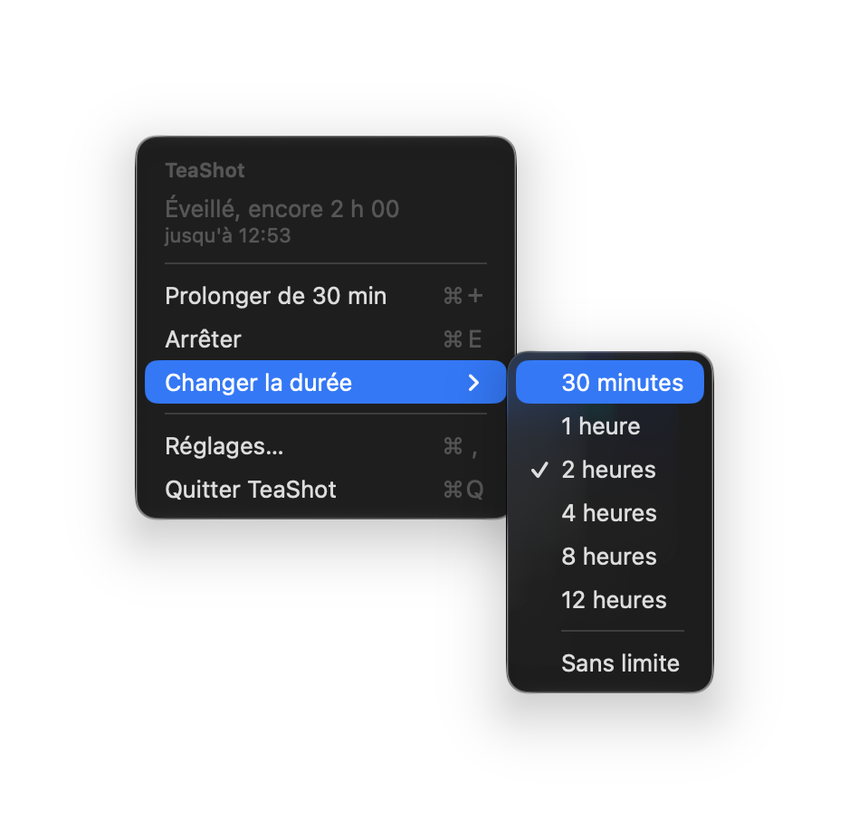

<p align="center">
  <picture>
    <source media="(prefers-color-scheme: dark)" srcset="docs/brand/hero-dark.png">
    <source media="(prefers-color-scheme: light)" srcset="docs/brand/hero-light.png">
    
  </picture>
</p>

<p align="center">
  
  
</p>

**TeaShot keeps your Mac awake from the menu bar.** It does what `caffeinate -dims` does, with a click instead of a terminal, and without touching your Energy or Battery settings. It was built for people who leave AI coding agents such as Claude Code or Codex running for hours: the Mac must not fall asleep in the middle of a task.

<p align="center">
  
</p>

## Install

Paste this line in Terminal:

```sh
curl -fsSL https://raw.githubusercontent.com/PillowPillow/tea-shot/main/install.sh | bash
```

It downloads the latest release, installs it in `/Applications` (or `~/Applications` if that folder is not writable) and launches it. Run the same line again to update.

> **Why a script?** TeaShot is free and is not notarized by Apple, which requires a paid developer account. Files downloaded with `curl` are not quarantined, so the app opens without the Gatekeeper warning. The script is short and readable: [read `install.sh`](install.sh) before you run it.

TeaShot requires macOS 14 Sonoma or later and runs on Apple silicon and Intel Macs.

<details>
<summary><strong>Install manually</strong></summary>

1. Download `TeaShot.zip` from the [latest release](https://github.com/PillowPillow/tea-shot/releases/latest).
2. Unzip it and drag TeaShot to your Applications folder.
3. Open TeaShot. macOS blocks the first launch: open **System Settings → Privacy & Security** and click **Open Anyway**. You only do this once.

</details>

<details>
<summary><strong>Build from source</strong></summary>

You need Xcode 26 or later. No Apple account is needed: builds are signed to run locally.

```sh
git clone https://github.com/PillowPillow/tea-shot.git
cd tea-shot
make install
```

</details>

**Uninstall:** quit TeaShot from its menu, then delete `TeaShot.app`. From a source checkout, `make uninstall` does both.

## Features

- **Awake with no limit, or for a set time.** Press <kbd>⌘E</kbd> to start, or choose 30 minutes, 1, 2, 4, 8 or 12 hours. You choose what <kbd>⌘E</kbd> starts in Settings.
- **Extend or stop at any time.** <kbd>⌘+</kbd> adds 30 minutes to the running timer.
- **A cup that drains.** The menu bar icon is a glass shot cup of green tea. It empties in five steps as the timer runs out, with the remaining time next to it. You can turn the time off.
- **A reminder before the end.** An optional notification arrives 1, 5 or 10 minutes before the timer ends, with an **Extend by 30 min** button.
- **Launch at login**, if you want TeaShot always at hand.

<p align="center">
  <picture>
    <source media="(prefers-color-scheme: dark)" srcset="docs/brand/glyph-steps-dark.png">
    <source media="(prefers-color-scheme: light)" srcset="docs/brand/glyph-steps-light.png">
    
  </picture>
</p>

<p align="center">
  
</p>

> The interface is in French only for now. Localization contributions are welcome.

## How it works

TeaShot creates the same IOKit power assertions as `caffeinate`, directly, with no `caffeinate` subprocess. Idle sleep is always blocked while TeaShot is active. The other three assertions are settings.

| Assertion | `caffeinate` flag | Setting |
| --- | --- | --- |
| `PreventUserIdleSystemSleep` | `-i` | Always on |
| `PreventUserIdleDisplaySleep` | `-d` | Keep display on |
| `PreventDiskIdle` | `-m` | Keep disk awake |
| `PreventSystemSleep` | `-s` | Block system sleep on AC power |

macOS releases the assertions automatically if TeaShot quits or crashes, so your Mac never stays stuck awake. To see them for yourself:

```sh
pmset -g assertions | grep -A1 TeaShot
```

## Accessibility

- VoiceOver reads the full state on the menu bar item, for example "TeaShot, awake for 2 more hours, until 12:43" (in French in the app). Durations are spelled out, and the state never depends on the cup drawing alone.
- The menu is a native `NSMenu` and Settings is a SwiftUI `Form`, so the keyboard and VoiceOver work as they do in the rest of macOS.
- The accent colour has variants for Dark Mode and for Increase Contrast.

## Privacy

TeaShot has no network access and no analytics. It runs in the App Sandbox without the network entitlement, with the Hardened Runtime enabled.

## Limits

These limits come from macOS, not from TeaShot.

- **Closing the lid still puts the Mac to sleep**, unless it is on AC power with an external display connected.
- **On battery, macOS ignores `PreventSystemSleep`.** Idle sleep is still blocked.
- **A crowded menu bar hides icons.** On a MacBook with a notch, macOS hides the items that do not fit. If the cup disappears, turn off the remaining time in Settings to make the item narrower.

## Development

TeaShot is a native Swift 6 app (AppKit and SwiftUI), built as a universal binary. The release zip is about 600 KB. You need Xcode 26 or later.

| Command | Effect |
| --- | --- |
| `make test` | Runs the Swift Testing suite |
| `make run` | Builds a Release build and launches it |
| `make install` | Installs the app in `/Applications` and launches it |
| `make uninstall` | Quits the app and deletes it |
| `make zip` | Builds `build/TeaShot.zip` |

**Architecture.** `AppModel` coordinates `SleepGuard` (assertions and timer), `AppSettings` (UserDefaults) and `TimerReminder` (notifications). `StatusItemController` owns the menu bar item and its menu in AppKit. `SettingsWindowController` hosts the SwiftUI settings.

**Adding files.** The project uses synchronized folders: a file added under `TeaShot/` or `TeaShotTests/` compiles without a change to the `.xcodeproj`.

**App icon.** Regenerate the 1024 px icon, then use `sips -z` for the 16 to 512 px sizes:

```sh
swift Tools/render-app-icon.swift TeaShot/Assets.xcassets/AppIcon.appiconset/icon_1024.png
```

**README visuals.** Regenerate the images in `docs/brand/` with `swift docs/brand/render-brand.swift .`

**Releases.** Pushing a tag `vX.Y.Z` triggers a GitHub Actions workflow that runs the tests, builds the universal zip and publishes the GitHub release.

## License

Copyright © 2026 PillowPillow. TeaShot is free software released under the GNU General Public License v3.0 — see [LICENSE](LICENSE).
